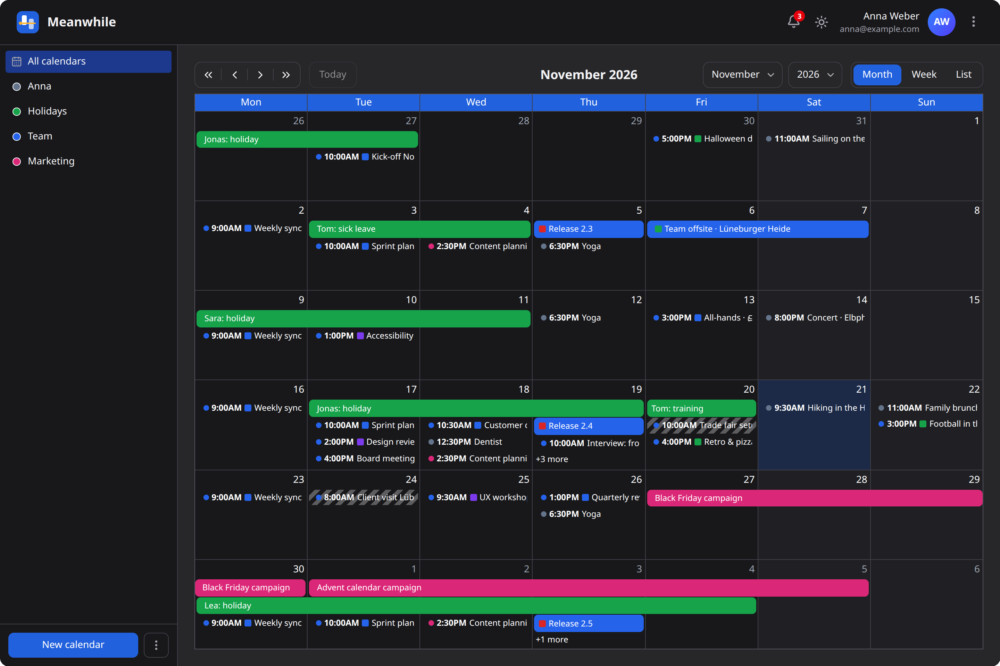
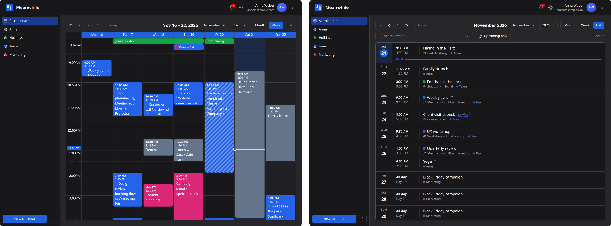

# Meanwhile

Meanwhile is a group calendar for teams and organisations that want to keep their dates on their
own server. People share calendars with each other, book rooms and equipment (with approval where
needed), invite participants by email and keep everything in sync with the calendar apps on their
phones and computers. It runs self-hosted with Docker, in English and German.





## Features

### Calendars and events

- **Shared calendars** with roles per member: owner, full access, own events only, or read only.
- **Recurring events** with exceptions: change or delete a single occurrence or all following ones.
- **Folders** to arrange your own calendar list.
- **Reminders** per event and person; they pop up in every open tab.
- **Live updates**: calendars, lists and notifications refresh by themselves when someone else
  changes something, in the browser or from a phone.

### Bookings and invitations

- **Bookable resources** such as rooms, cars or projectors, with an approval step where wanted;
  overlapping bookings are refused.
- **Invitations by email** that participants answer from their mail program (Outlook,
  Thunderbird, Apple Mail, Gmail …) or with a link, no account needed.
- **Email notifications** for approvals, decisions, comments, shared calendars and answers, each
  one chosen per person, in their language and time zone.

### Calendar apps

- **CalDAV** for phones and desktop calendars, signed in with app passwords that can be revoked
  one by one; the account password never goes into a calendar app.
- **iCal feed** per calendar under a secret link that can be renewed at any time.

### Administration and security

- **Users and roles**: open or closed registration, an administrator from the configuration.
- **Hardened container**: read-only, unprivileged, without capabilities; the image carries a
  build provenance attestation.
- **Nightly backups** of the database, kept for a configurable number of days.

## Quick start with Docker

You need Docker with the Compose plugin. Meanwhile runs from the published image
`ghcr.io/marank/meanwhile`; the server needs only two files.

1. Download `compose.yml` and the example configuration:

   ```bash
   mkdir meanwhile && cd meanwhile
   curl -fsSLO https://raw.githubusercontent.com/marank/meanwhile/main/compose.yml
   curl -fsSL https://raw.githubusercontent.com/marank/meanwhile/main/.env.example -o .env
   ```

2. Edit `.env` and set at least these values:

   | Variable | Value |
   | --- | --- |
   | `APP_URLS` | The address users open, e.g. `https://calendar.example.com`. To try it on your own machine: `http://localhost:6326`. |
   | `SECRET_KEY` | A random string of at least 40 characters. Meanwhile does not start with the placeholder. |
   | `DB_PASSWORD` | Password of the database, used only between the containers. |
   | `ADMIN_EMAIL`, `ADMIN_PASSWORD` | Sign-in of the first administrator. |

   Generate the random values with `openssl rand -hex 32`.

3. Start Meanwhile and its database:

   ```bash
   docker compose up -d
   ```

Open <http://localhost:6326> and sign in with `ADMIN_EMAIL` and `ADMIN_PASSWORD`. Updates:
`docker compose pull && docker compose up -d`; migrations run on every start.

For real use, put a TLS proxy in front and set `TRUSTED_PROXIES`, see
[Operations](docs/operations.md#reverse-proxy-and-tls).

## Operations

- **TLS:** put a TLS proxy in front that also passes WebSockets on, and set `TRUSTED_PROXIES` to
  its address; examples for Caddy and nginx are in [docs/operations.md](docs/operations.md).
- **Settings:** every variable is explained in [`.env.example`](.env.example).
- **Email and invitations:** an SMTP server for sending; an IMAP mailbox if answers from mail
  programs should count, see [docs/operations.md](docs/operations.md#email-and-invitations).
- **Backups:** the worker dumps the database nightly into the `backups` volume;
  `docker compose exec worker python manage.py backup_database` dumps right away. Restoring and
  updating: [docs/operations.md](docs/operations.md#backups).
- **Calendar apps:** CalDAV is served under `/caldav` (found via `/.well-known/caldav`); users
  create app passwords in their account settings.

## Contributing

Meanwhile is still in active development, so pull requests are not accepted yet; bug reports
and ideas are welcome as issues. See [CONTRIBUTING.md](CONTRIBUTING.md).

To run Meanwhile from source:

```bash
cp .env.example .env && just setup
just dev             # backend and frontend → http://localhost:6326
```

## License

Meanwhile is licensed under the [GNU Affero General Public License v3.0 or later](LICENSE).
Running a modified Meanwhile for others over a network obliges you to offer them its source.
